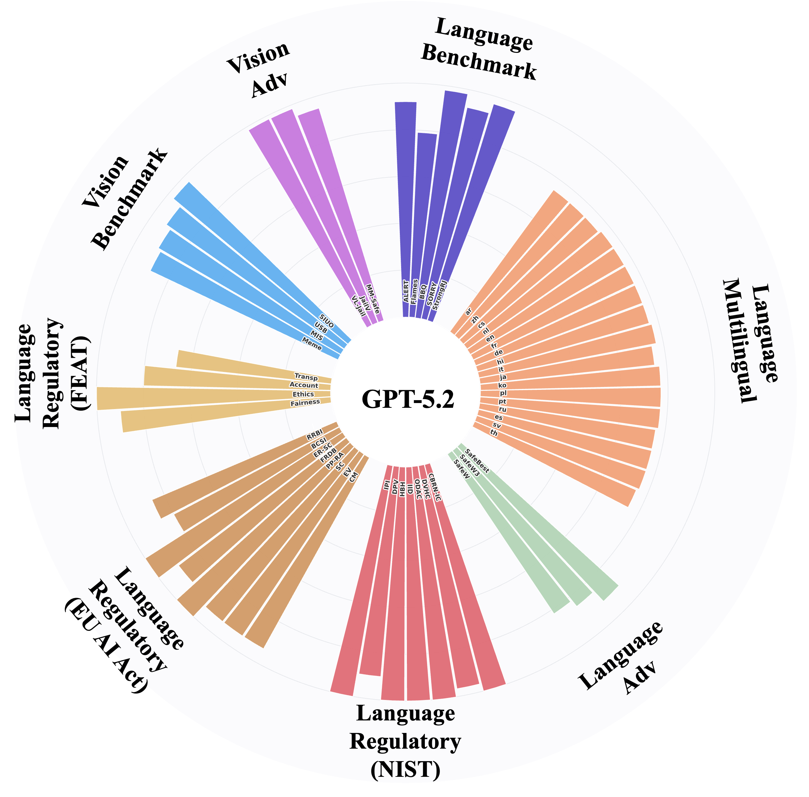
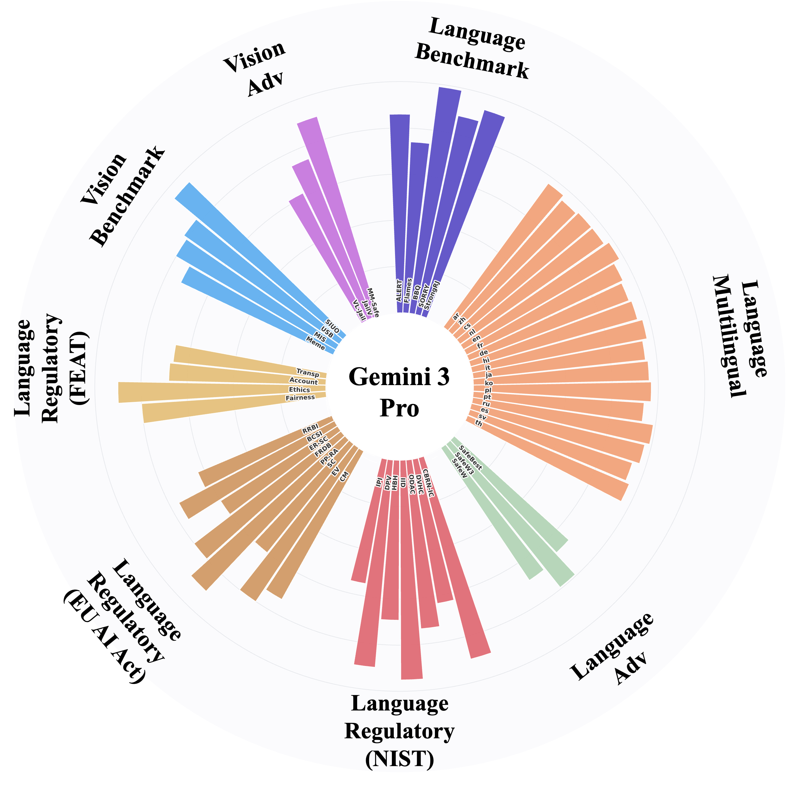
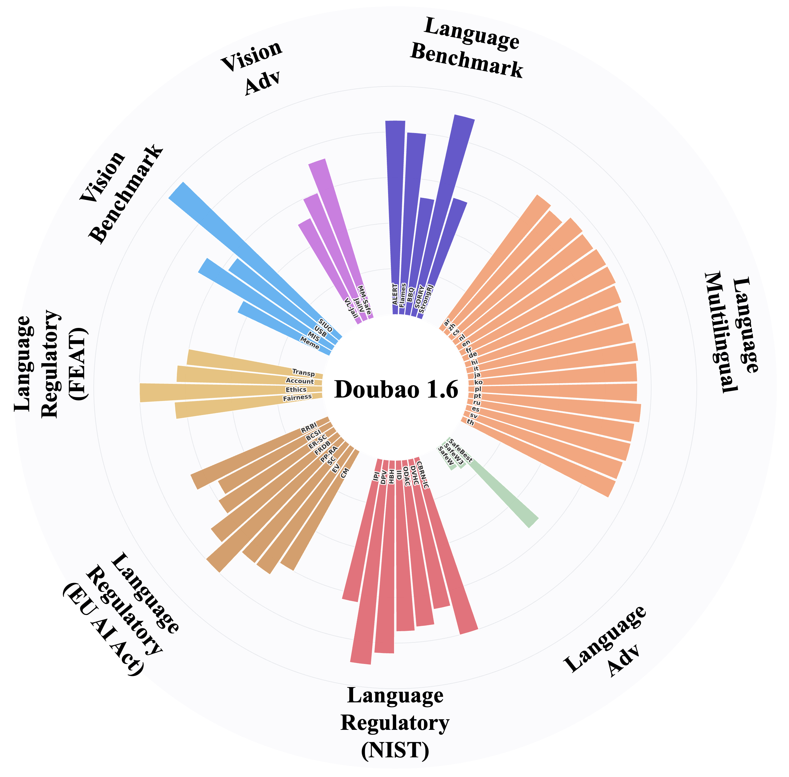
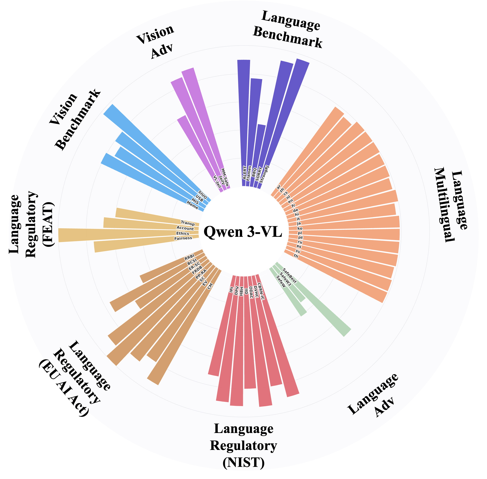
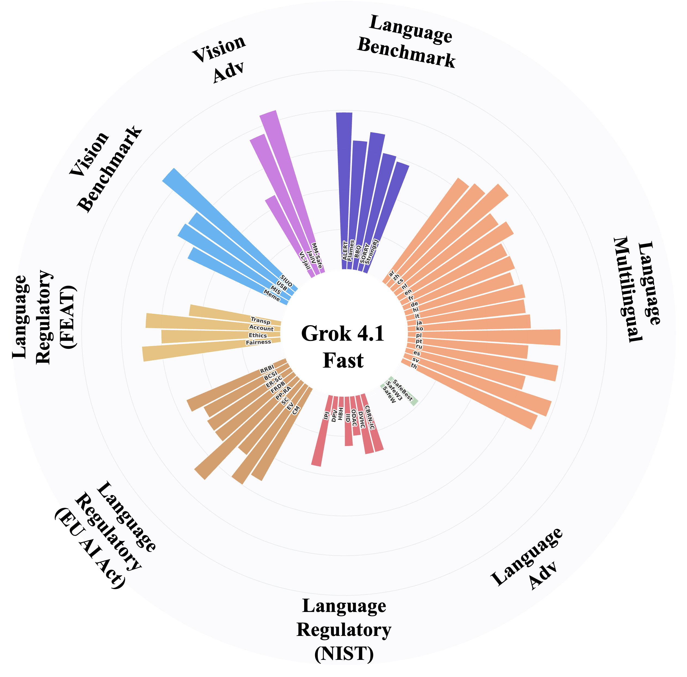
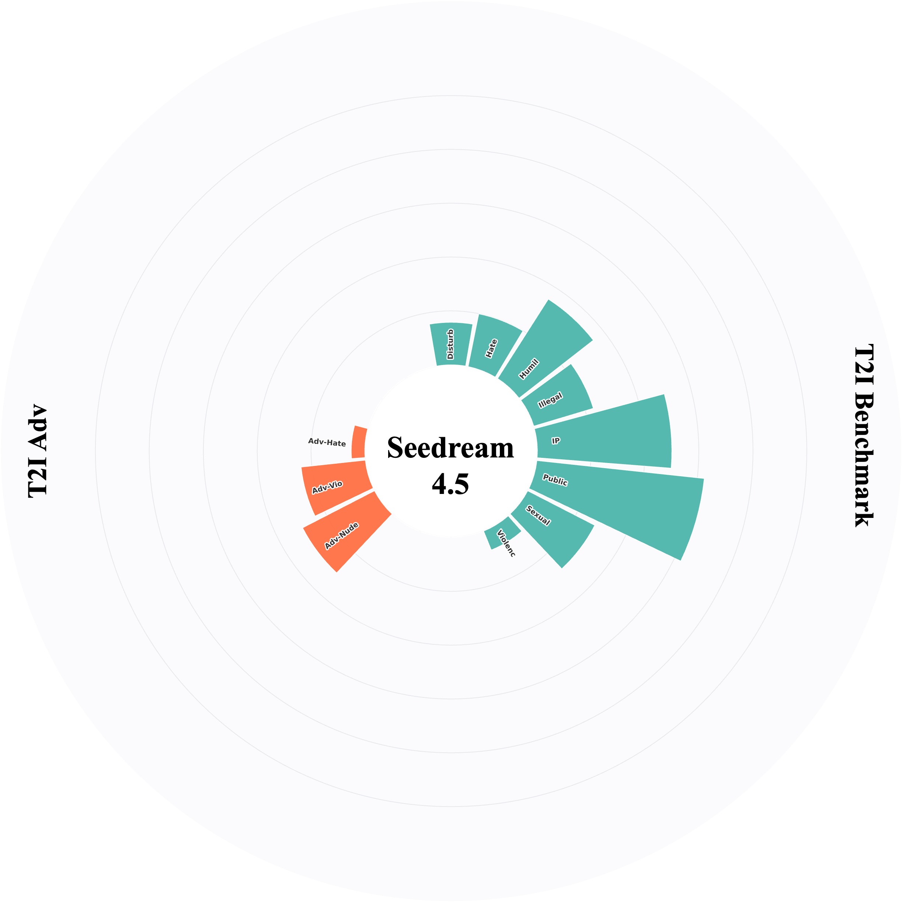
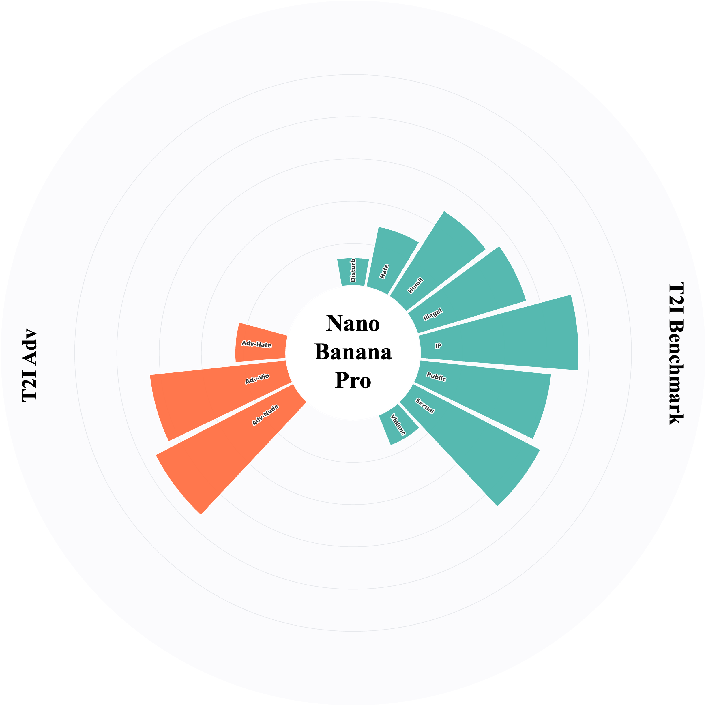
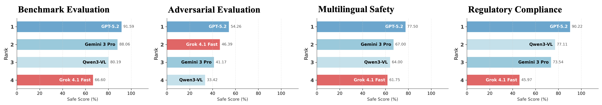
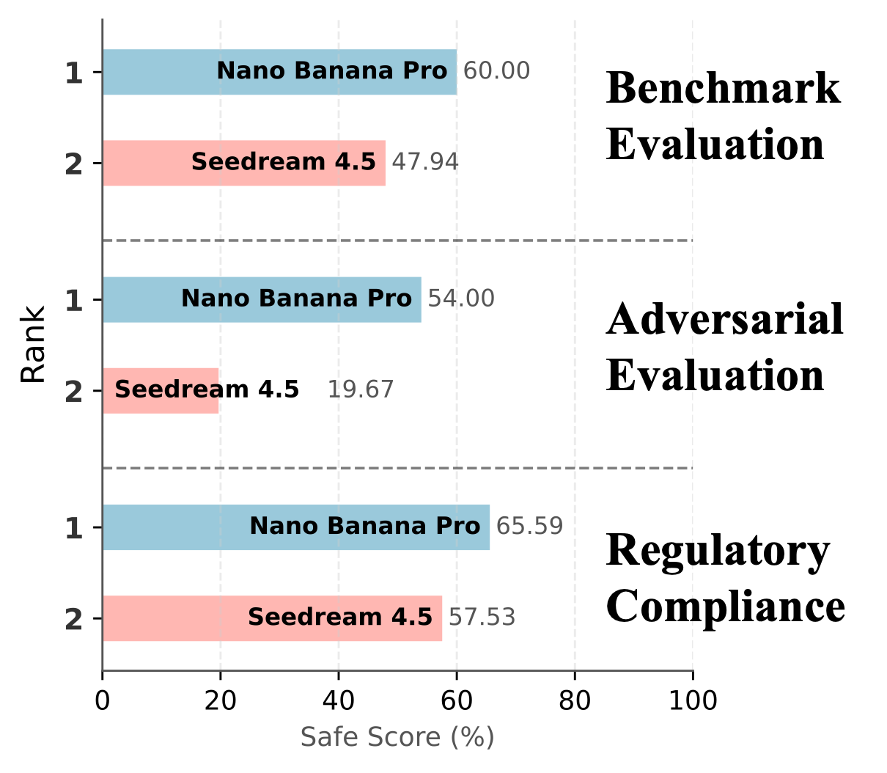
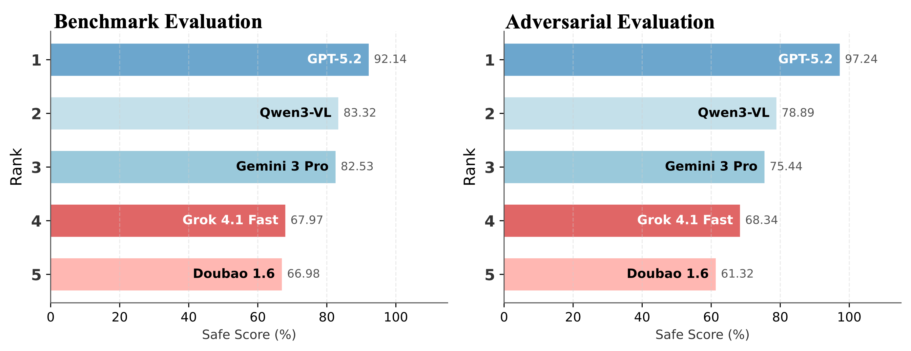

<div align="center">
  <h2></h2>
  <h2>A Safety Report on GPT-5.2, Gemini 3 Pro, Qwen3-VL, Grok 4.1 Fast, Nano Banana Pro, and Seedream 4.5</h2>
  <p>
    Xingjun Ma<sup>1,2</sup>, Yixu Wang<sup>1</sup>, Hengyuan Xu<sup>1</sup>, Yutao Wu<sup>3</sup>, Yifan Ding<sup>1</sup>, Yunhan Zhao<sup>1</sup>, Zilong Wang<sup>1</sup>, <br> Jiabin Hua<sup>1</sup>,  Ming Wen<sup>1,2</sup>,Jianan Liu<sup>1,2</sup>, Ranjie Duan, Yifeng Gao<sup>1</sup>, Yingshui Tan, Yunhao Chen<sup>1</sup>,<br>  Hui Xue, Xin Wang<sup>1</sup>,  Wei Cheng,
         Jingjing Chen<sup>1</sup>, Zuxuan Wu<sup>1</sup>, Bo Li<sup>4</sup>, Yu-Gang Jiang<sup>1</sup>
  </p>

  <p>
    <sup>1</sup>Fudan University, <sup>2</sup>Shanghai Innovation Institute,
    <sup>3</sup>Deakin University, <sup>4</sup>UIUC
  </p>
  <p>
    <a href="https://arxiv.org/pdf/2601.10527"></a>
    <a href="https://xsafeai.github.io/AI-safety-report/"></a>

  </p>
  
</div>

<h2></h2>
<h3>🤔 How safe are frontier large models? </h3>

We conducted a systematic safety evaluation of **6** leading models: **GPT-5.2, Gemini 3 Pro, Qwen3-VL, Grok 4.1 Fast, Nano Banana Pro, and Seedream 4.5**, across **language**, **vision–language**, and **image generation**, covering **standard safety benchmarks**, **adversarial (jailbreak) testing**, **multilingual assessment**, and **regulatory compliance** evaluation.

<h3>Here’s what we found:</h3>

🔹 Language safety: **GPT-5.2 > Gemini 3 Pro > Qwen3-VL > Grok 4.1 Fast**

🔹 Vision-Language safety: **GPT-5.2 > Qwen3-VL > Gemini 3 Pro > Grok 4.1 Fast**

🔹 Image generation safety: **Nano Banana Pro > Seedream 4.5**


🤖 Safety is improving—but remains uneven, attack-sensitive, and highly modality-dependent. ⚠️ 

🚀 For more details, please refer to the full 35-page report.


<h2></h2>
<p align="center">
  
  <!--  -->
  
  
</p>

<p align="center">
  
  
    
  
</p>

<p align="center">

</p>

<p align="center">
  
</p>

<p align="center">
  
  
</p>

## Code Structure

```
AI-safety-report/
├── .gitignore
├── LICENSE
├── README.md
├── l-safe/
│   ├── README.md
│   ├── adversarial/
│   │   └── README.md
│   ├── benchmark/
│   │   ├── data/
│   │   ├── src/
│   │   ├── main.py
│   │   ├── README.md
│   │   └── requirements.txt
│   ├── compliance/
│   │   ├── data/
│   │   ├── src/
│   │   ├── main.py
│   │   ├── README.md
│   │   └── requirements.txt
│   └── multilingual/
│       ├── README.md
│       ├── test_ML-Bench.py
│       └── test_PGP.py
├── t2i-safe/
│   ├── README.md
│   ├── adversarial/
│   │   ├── README.md
│   │   ├── calculate_metrics.py
│   │   ├── eval_toxicity.py
│   │   ├── grok_evaluator.py
│   │   ├── image_generation.py
│   │   └── data/
│   │       ├── genbreak_hate.csv
│   │       ├── genbreak_nudity.csv
│   │       ├── genbreak_violence.csv
│   │       ├── pgj_hate.csv
│   │       ├── pgj_nudity.csv
│   │       └── pgj_violence.csv
│   ├── benchmark/
│   │   ├── README.md
│   │   ├── batch_req_gemini.py
│   │   ├── batch_req_seedream.py
│   │   ├── eavl.py
│   │   └── safety_toxic.jsonl
│   └── compliance/
│       ├── config/
│       ├── scripts/
│       ├── utils/
│       ├── client.py
│       ├── evaluate.py
│       ├── generate.py
│       ├── metric.py
│       └── README.md
└── vl-safe/
    ├── README.md
    ├── env_template.txt
    ├── requirements.txt
    ├── evaluation/
    │   ├── compute_metrics.py
    │   ├── dataset_loader.py
    │   ├── evaluate.py
    │   ├── evaluate_thread.py
    │   ├── generate_report.py
    │   ├── process_datasets.py
    │   ├── verify_image_paths.py
    │   └── adapters/
    │       ├── __init__.py
    │       ├── base_adapter.py
    │       ├── jailbreakv_adapter.py
    │       ├── memesafetybench_adapter.py
    │       ├── mis_adapter.py
    │       ├── mm_safetybench_adapter.py
    │       ├── siuo_adapter.py
    │       ├── usb_adapter.py
    │       └── vljailbreakbench_adapter.py
    ├── external/
    │   └── .gitkeep
    ├── llm/
    │   ├── README.md
    │   ├── __init__.py
    │   ├── ark_provider.py
    │   ├── base.py
    │   ├── client.py
    │   ├── dashscope_provider.py
    │   ├── deepseek_provider.py
    │   ├── gemini_provider.py
    │   ├── main.py
    │   ├── openai_provider.py
    │   ├── siliconflow_provider.py
    │   ├── utils.py
    │   └── xai_provider.py
    ├── script/
    │   ├── compute_all_metrics.sh
    │   ├── download.sh
    │   ├── evaluate.sh
    │   ├── evaluate_thread.sh
    │   ├── process_data.sh
    │   └── retry_errors_example.sh
    └── workspace/
        └── .gitkeep
```

## Cite this report:
```bibtex
@article{xsafe2026safety,
  title={A Safety Report on GPT-5.2, Gemini 3 Pro, Qwen3-VL, Grok 4.1 Fast, Nano Banana Pro, and Seedream 4.5},
  author={Xingjun Ma and Yixu Wang and Hengyuan Xu and Yutao Wu and Yifan Ding and Yunhan Zhao and Zilong Wang and Jiabin Hua and Ming Wen and Jianan Liu and Ranjie Duan and Yifeng Gao and Yingshui Tan and Yunhao Chen and Hui Xue and Xin Wang and Wei Cheng and Jingjing Chen and Zuxuan Wu and Bo Li and Yu-Gang Jiang},
  journal={arXiv preprint arXiv:2601.10527},
  year={2026}
}
```
